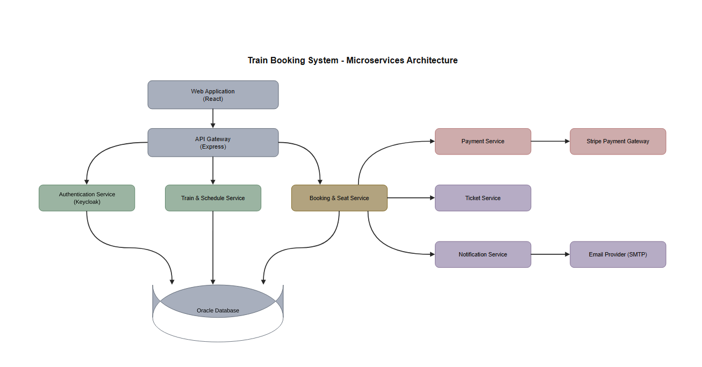

# Train Booking System

## 1. Microservices Architecture

## 2. Flows

### Flow 1 — Register and login

**Register**
1. Web App sends the registration data (name, email, password) to the Gateway.
2. Gateway forwards it to the Auth Service.
3. Auth saves the user in PostgreSQL. The password is stored as a hash.
4. Auth confirms the account was created.

**Login**
1. Web App sends email and password to the Gateway.
2. Gateway forwards the request to Auth.
3. Auth looks up the user and verifies the password hash.
4. Auth signs a **JWT** containing the user id and role (`USER` / `ADMIN`) and returns it.
5. Web App sends the JWT with every later request. The Gateway verifies it before routing.

### Flow 2 — Search trips and view the seat map

**Search**
1. Web App sends the search (from, to, date) to the Gateway.
2. Gateway verifies the JWT and forwards the request to Train & Schedule.
3. Train & Schedule returns the trips that run from the origin to the destination on that date, with times.

**Seat map**
1. User opens a trip. Web App sends the trip, boarding stop and destination stop to the Gateway.
2. Gateway gets the coaches, seat layout and standing capacity from Train & Schedule.
3. Gateway gets the availability for this journey from Booking & Seat.
   - A seat is available only if it is free on **every segment** between the boarding stop and the destination.
   - Standing places left = the lowest remaining count across those segments.
4. Web App draws the seat map: each seat is **available**, **held**, **booked** or **selected**, with the standing places left.

**Live updates**
1. Web App opens a WebSocket for the trip, through the Gateway.
2. When any seat is held, released or booked, Booking & Seat pushes the change.
3. Web App updates the seat map instantly, without reloading. If a seat the user selected becomes unavailable, it is deselected and the user is told.
4. After a reconnect, the Web App reloads the full availability to avoid missing changes.

### Flow 3 — Hold seats

1. User confirms the selected seats and/or standing places. Web App sends the trip, journey and selection to the Gateway.
2. Gateway forwards it to Booking & Seat.
3. Booking & Seat tries to hold the seats on **every segment** of the journey in one database transaction. The database rejects a seat that is already held or booked on any segment. The hold is all-or-nothing.
4. **If any seat was just taken:** nothing is held. Booking returns "no longer available" with the lost seats, and the Web App refreshes the seat map.
5. **If all seats are free:**
   - The booking is created as `PENDING_PAYMENT` with `expires_at` = now + **5 minutes**.
   - Booking returns `expires_at` and the Web App opens the payment page with a 5:00 countdown.
   - Booking pushes "seats held" over WebSocket, so other users see them as held immediately.

### Flow 4 — Pay and receive the ticket

**Start payment**
1. The payment page opens after the hold (Flow 3). Web App asks the Gateway, which forwards the request to Booking & Seat.
2. Booking checks that the hold is still active (`expires_at` has not passed). If not, it refuses (Flow 5).
3. Booking asks Payment to create a payment. The amount is calculated on the server.
4. Payment creates the payment with Stripe and returns a client secret.
5. Web App shows Stripe's secure payment form **inside our payment page**, next to the 5:00 countdown. Because the form is part of our page, a timeout can send the user back to the seat map (Flow 5).

**Pay**
1. User enters card details in Stripe's form. Card data goes straight to Stripe and never reaches our system.
2. Stripe sends a **webhook** with the result to the Gateway, which forwards it to Payment.
3. Payment verifies the Stripe webhook signature and ignores duplicate events.
4. Payment tells Booking that the payment succeeded.
5. Booking sets the booking to `CONFIRMED`.

**Ticket and email**
1. Booking asks the Ticket Service to generate the ticket (PDF with QR code).
2. Booking asks the Notification Service to email the ticket to the user.
3. Notification sends the email through the email provider. This runs asynchronously and retries on failure. **An email failure never cancels a booking.** The user can re-send the ticket from "My bookings".
4. Booking pushes "seats booked" over WebSocket and the Web App shows the confirmation.

### Flow 5 — Hold timeout (user is sent back, never charged)

When the 5 minutes run out, the user must not be able to pay. The payment is blocked **before** any money moves, so no refund is needed.

1. The countdown on the payment page reaches 0:00 and the payment form is disabled.
2. A job inside Booking & Seat runs every few seconds and finds holds past `expires_at`. Booking also refuses any new payment request for an expired hold.
3. Booking asks Payment to **cancel the pending Stripe payment first**. Stripe then rejects any later attempt to pay it.
4. Once Stripe confirms the cancellation, Booking releases the seats on every segment and sets the booking to `EXPIRED`.
5. Booking pushes "hold expired" to the user's browser. The Web App **redirects the user back to the seat map** for that trip with the message "Your 5 minutes ran out. The seats were released, please select again."
6. Booking pushes "seats released" over WebSocket, so other users see the seats as available immediately.

**Payment at the last second**
- If Stripe refuses the cancellation because the payment already succeeded or is being processed, the payment wins: Booking confirms the booking and continues with the ticket and email (Flow 4) instead of expiring it.
- The seats of a paid booking are never released, and an expired hold is never charged.

### Flow 6 — Cancel and refund (done by the admin as support)

Users do not cancel on their own. A user who wants to cancel asks the admin (support), and the admin cancels the booking on their behalf. "My bookings" shows the booking status and a "Contact support to cancel" note instead of a cancel button.

1. The user contacts support with the booking reference.
2. Admin searches for the booking (Flow 7, Support) and opens it. Web App sends the request to the Gateway, which checks the `ADMIN` role and forwards it to Booking & Seat.
3. Admin chooses **Cancel booking** and enters a reason.
4. Booking checks that the booking is `CONFIRMED` and the train has not departed. Otherwise the cancellation is refused with the reason.
5. Booking releases the seats on every segment and sets the booking to `CANCELLED`. It records which admin cancelled it and the reason.
6. Booking asks the Ticket Service to invalidate the ticket's QR code.
7. Booking asks Payment to refund. Payment sends the refund request to Stripe. The refund status becomes `REFUND_PENDING`.
8. Stripe later confirms the refund by webhook. The status becomes `REFUNDED`, or `REFUND_FAILED` for admin follow-up.
9. Booking asks Notification to email the cancellation and refund details to the user.
10. Booking pushes "seats released" over WebSocket, so other users' seat maps update immediately.

### Flow 7 — Admin: manage trains and support

All admin requests carry a JWT with the `ADMIN` role. The Gateway rejects other roles with `403`.

**Create a train**
1. Admin submits the train (number, name, type, status).
2. Gateway checks the role and forwards the request to Train & Schedule.
3. Train & Schedule saves the train in PostgreSQL.

**Define coaches, seats and standing capacity**
1. Admin adds a coach (code, class), its seats (number, row, column) and its **standing capacity**.
2. Train & Schedule saves the coaches, seats and capacity. These define the seat map shown to passengers.

**Update**
1. Admin edits a train, coach, seat or capacity.
2. Removing seats or lowering standing capacity is **rejected** if future trips already have holds or confirmed bookings that use them.

**Delete**
1. Admin deletes a train.
2. Train & Schedule checks for future trips with confirmed bookings.
3. If there are any, the delete is refused (deactivate the train instead, or cancel those bookings first as in Flow 6). Otherwise the train is deleted.

**Read**
- Admin lists and filters trains by number, name and status.

**Support: look up and cancel bookings**
1. Admin searches bookings by booking reference, user email, trip or status. Gateway checks the `ADMIN` role and forwards the request to Booking & Seat.
2. Booking returns the booking details: user, trip, journey, seats, status, payment status and refund status.
3. To cancel a booking for a user who asked, the admin follows Flow 6.
4. Admin can also see the `REFUND_FAILED` bookings and follow them up.
