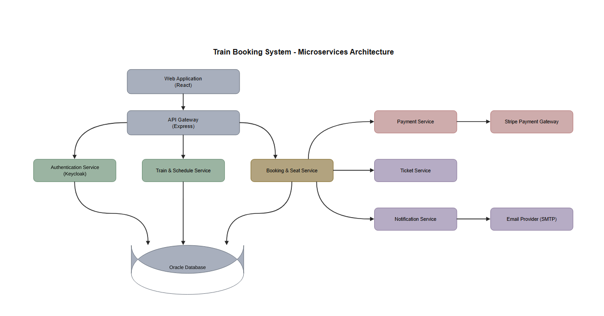

# Train Booking System

## 1. Microservices Architecture

## 2. Flows

### Flow 1 — Register and login

The Authentication Service is **Keycloak**. It stores the users, hashes the passwords, shows the login and registration pages, and issues the JWTs. We write no login code of our own.

**Register**
1. User clicks Register in the Web App. The browser goes **directly to Keycloak's** registration page. This step does not pass through the Gateway.
2. User enters name, email and password. Keycloak validates them and creates the account in its database (Oracle). The password is stored as a hash.
3. The new user gets the realm role `USER`. Admin accounts get the role `ADMIN`, assigned in Keycloak by an administrator.

**Login**
1. User clicks Login in the Web App. The browser goes **directly to Keycloak's** login page (authorization code flow with PKCE).
2. Keycloak verifies the email and password.
3. Keycloak redirects back to the Web App, which exchanges the code with Keycloak for a signed **JWT** (access token) containing the user id and the role (`USER` / `ADMIN`).
4. From then on, Web App sends the JWT to the **Gateway** with every API request.
5. The Gateway verifies the token signature with Keycloak's public keys (fetched from Keycloak and cached), checks that it has not expired, and reads the role before routing. The user id in the token identifies the user in all other services.

### Flow 2 — Search trips and view the seat map

**Search**
1. Web App sends the search (from, to, date) to the Gateway.
2. Gateway verifies the JWT and forwards the request to Train & Schedule.
3. Train & Schedule returns the trips that run from the origin to the destination on that date, with times. Cancelled trips are not returned.

**Seat map**
1. User opens a trip. Web App sends the trip, boarding stop and destination stop to the Gateway.
2. Gateway gets the coaches, seat layout and standing capacity from Train & Schedule.
3. Gateway gets the availability for this journey from Booking & Seat.
   - A seat is available only if it is free on **every segment** between the boarding stop and the destination.
   - Standing places left = the lowest remaining count across those segments.
4. Web App draws the seat map: each seat is **available**, **held**, **booked** or **selected**, with the standing places left.

**Live updates**
1. Web App opens a WebSocket for the trip, through the Gateway.
2. When any seat is held, released or booked, Booking & Seat pushes the change.
3. Web App updates the seat map instantly, without reloading. If a seat the user selected becomes unavailable, it is deselected and the user is told.
4. After a reconnect, the Web App reloads the full availability to avoid missing changes.

### Flow 3 — Hold seats (the hold starts when the first seat is picked)

There is no separate "confirm" step to start the hold. The 5 minutes start the moment the user picks the first seat or standing place, and the seats stay held while the user continues to the payment page.

1. User picks a seat or a standing place on the seat map. Web App sends the trip, journey and the pick to the Gateway, which forwards it to Booking & Seat. Booking refuses the request if the trip was closed or cancelled (Flow 8).
2. **First pick (the user has no active hold on this trip):**
   - Booking & Seat tries to hold the seat on **every segment** of the journey in one database transaction. The database rejects a seat that is already held or booked on any segment.
   - If it succeeds, the booking is created as `PENDING_PAYMENT` with `expires_at` = now + **5 minutes**. The timer starts now.
   - Booking returns `expires_at`, and the Web App shows a countdown on the seat map.
3. **Further picks:** each one is added to the same booking in its own all-or-nothing transaction. `expires_at` does **not** change, so the timer is never extended.
4. **Deselecting** a seat releases it at once. If the last seat is released, the hold ends and the booking is `ABANDONED`.
5. **If a seat was just taken by someone else:** that pick fails with "no longer available" and the Web App refreshes the seat map. The seats already held stay held.
6. Booking pushes "seats held" and "seats released" over WebSocket after each change, so other users see them immediately.
7. When the user is ready, they choose **Continue to payment** and the Web App opens the payment page (Flow 4). The countdown continues with the remaining time, not a fresh 5:00.
8. If the time runs out at any point, the hold timeout in Flow 5 applies.

### Flow 4 — Pay and receive the ticket

**Start payment**
1. The payment page opens when the user chooses Continue to payment (Flow 3). Web App asks the Gateway, which forwards the request to Booking & Seat.
2. Booking checks that the hold is still active (`expires_at` has not passed). If not, it refuses (Flow 5).
3. Booking asks Payment to create a payment. The amount is calculated on the server.
4. Payment creates the payment with Stripe and returns a client secret.
5. Web App shows Stripe's secure payment form **inside our payment page**, next to the countdown with the remaining time. Because the form is part of our page, a timeout can send the user back to the seat map (Flow 5).

**Pay**
1. User enters card details in Stripe's form. Card data goes straight to Stripe and never reaches our system.
2. Stripe sends a **webhook** with the result to the Gateway, which forwards it to Payment.
3. Payment verifies the Stripe webhook signature and ignores duplicate events.
4. Payment tells Booking that the payment succeeded.
5. Booking sets the booking to `CONFIRMED`.

**Ticket and email**
1. Booking asks the Ticket Service to generate the ticket (PDF with QR code).
2. Booking asks the Notification Service to email the ticket to the user.
3. Notification sends the email through the email provider. This runs asynchronously and retries on failure. **An email failure never cancels a booking.** The user can re-send the ticket from "My bookings".
4. Booking pushes "seats booked" over WebSocket and the Web App shows the confirmation.

### Flow 5 — Hold timeout (user is sent back, never charged)

When the 5 minutes run out, the user must not be able to pay. The payment is blocked **before** any money moves, so no refund is needed.

1. The countdown, on the seat map or on the payment page, reaches 0:00 and the payment form (if open) is disabled.
2. A job inside Booking & Seat runs every second and finds holds past `expires_at`. Booking also refuses any new payment request for an expired hold.
3. Booking asks Payment to **cancel the pending Stripe payment first**. Stripe then rejects any later attempt to pay it.
4. Once Stripe confirms the cancellation, Booking releases the seats on every segment and sets the booking to `EXPIRED`.
5. Booking pushes "hold expired" to the user's browser. The Web App **redirects the user back to the seat map** for that trip with the message "Your 5 minutes ran out. The seats were released, please select again."
6. Booking pushes "seats released" over WebSocket, so other users see the seats as available immediately.

**Payment at the last second**
- If Stripe refuses the cancellation because the payment already **succeeded**, the payment wins: Booking confirms the booking and continues with the ticket and email (Flow 4) instead of expiring it.
- If the payment is still **processing**, Booking keeps the seats held and retries on the next sweep until Stripe settles. If it succeeds, the booking is confirmed. If it fails or is cancelled, the hold expires as above. Only card payments are accepted, so this takes seconds.
- The seats of a paid booking are never released, and an expired hold is never charged.

### Flow 6 — Cancel and refund (by the user, or by an admin as support)

A confirmed booking can be cancelled in two ways. Both run the **same cancellation** (below); they differ only in who starts it.

**Way A — the user cancels (instant)**
1. In "My bookings" the user opens a `CONFIRMED` booking, chooses **Cancel booking** and confirms. Web App sends the request to the Gateway, which forwards it to Booking & Seat.
2. Booking checks that the booking belongs to the caller (the user id in the JWT) and runs the cancellation. No approval is needed, so the seats are released immediately.

**Way B — an admin cancels on the user's behalf (support)**
This simulates a user who contacted customer support instead of cancelling in the app.
1. The user contacts support with the booking reference.
2. Admin searches for the booking (Flow 7, Support) and opens it. Web App sends the request to the Gateway, which checks the `ADMIN` role and forwards it to Booking & Seat.
3. Admin chooses **Cancel booking** and enters a reason. Booking runs the cancellation and records which admin did it and the reason.

**The cancellation (same for both ways)**
1. Booking checks that the booking is `CONFIRMED` and the train has not yet left the user's boarding stop. Otherwise the cancellation is refused with the reason. If the booking is already `CANCELLED`, Booking returns its current state, so a retry is safe.
2. Booking releases the seats on every segment and sets the booking to `CANCELLED`. It records who cancelled it: the user, or the admin with the reason.
3. Booking asks the Ticket Service to invalidate the ticket's QR code.
4. Booking asks Payment to refund. Payment sends the refund request to Stripe. The refund status becomes `REFUND_PENDING`.
5. Stripe later confirms the refund by webhook. The status becomes `REFUNDED`, or `REFUND_FAILED` for admin follow-up.
6. Booking asks Notification to email the cancellation and refund details to the user.
7. Booking pushes "seats released" over WebSocket, so other users' seat maps update immediately.

### Flow 7 — Admin: manage trains and support

All admin requests carry a Keycloak JWT with the `ADMIN` role. The Gateway rejects other roles with `403`.

**Create a train**
1. Admin submits the train (number, name, type, status).
2. Gateway checks the role and forwards the request to Train & Schedule.
3. Train & Schedule saves the train in the database (Oracle).

**Define coaches, seats and standing capacity**
1. Admin adds a coach (code, class), its seats (number, row, column) and its **standing capacity**.
2. Train & Schedule saves the coaches, seats and capacity. These define the seat map shown to passengers.

**Update**
1. Admin edits a train, coach, seat or capacity.
2. Removing seats or lowering standing capacity is **rejected** if future trips already have holds or confirmed bookings that use them.

**Delete**
1. Admin deletes a train.
2. Train & Schedule checks for future trips with confirmed bookings.
3. If there are any, the delete is refused (deactivate the train instead, or cancel the trips first as in Flow 8). Otherwise the train is deleted.

**Read**
- Admin lists and filters trains by number, name and status.

**Support: look up and cancel bookings**
1. Admin searches bookings by booking reference, user email, trip or status. Gateway checks the `ADMIN` role and forwards the request to Booking & Seat.
2. Booking returns the booking details: user, trip, journey, seats, status, payment status and refund status.
3. To cancel a booking for a user who asked, the admin follows Flow 6, Way B.
4. Admin can also see the `REFUND_FAILED` bookings and follow them up.

### Flow 8 — Admin cancels a whole trip

Used when a trip will not run (breakdown, strike, weather). Every booking on the trip is cancelled and fully refunded.

1. Admin selects the trip, chooses **Cancel trip** and enters a reason. Gateway checks the `ADMIN` role.
2. Gateway forwards the request to Booking & Seat. Booking checks that the trip has not yet left its first stop, then **closes the trip for new holds** and starts cancelling its bookings.
3. Booking tells Train & Schedule to mark the trip `CANCELLED`, so it disappears from search results. Booking retries this call until Train & Schedule accepts it.
4. Booking handles the **active holds** on the trip: it asks Payment to cancel the pending Stripe payment, releases the seats and sets the booking to `EXPIRED`. The user's payment page redirects back with the message "This trip was cancelled".
5. Booking handles each **confirmed booking** on the trip, one by one, as in the cancellation of Flow 6: release the seats, set `CANCELLED`, invalidate the ticket, refund the **full amount** through Payment and Stripe, and email the user that the trip was cancelled.
6. Booking pushes "trip cancelled" over WebSocket to everyone viewing the trip.
7. Each booking is processed independently and retried on failure. A refund that fails stays `REFUND_FAILED` for admin follow-up (Flow 7, Support).
8. If step 3 or step 5 fails part-way, the admin sees the trip as `CANCELLED - bookings pending` (Booking keeps its own copy of the trip as `CANCELLING` until every booking is processed) and can retry. Retrying is safe because bookings that are already cancelled are skipped.
